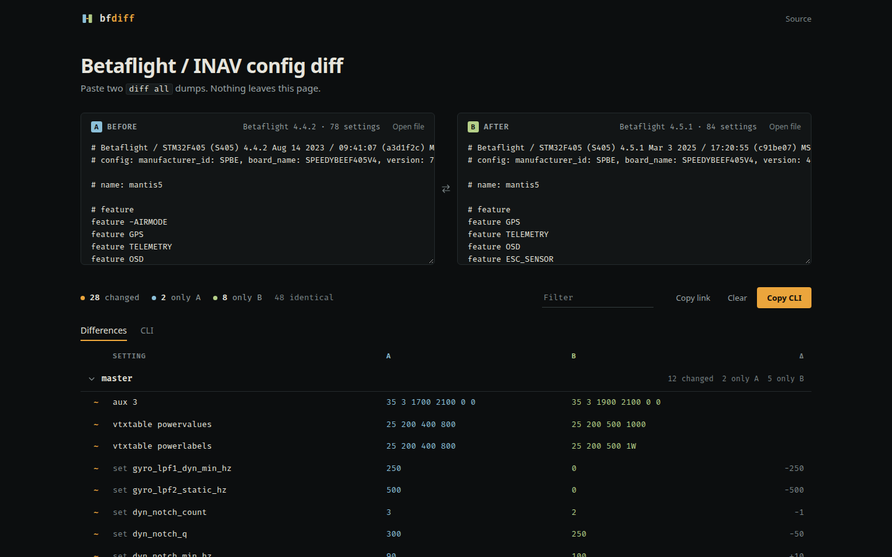

# bfdiff

Paste two Betaflight or INAV `diff all` dumps, see what changed, and get the CLI that turns one into the other.

**Try it: https://davdd1.github.io/betaflight-diff/**

I kept doing this by eye after every firmware update and every time someone sent me their tune. Generic text diffs are mostly noise (line order, on/off toggles, profiles interleaved), so this one parses the dump first and matches settings by name and profile.

## Use it

1. Run `diff all` in the Configurator CLI tab and copy the output. Plain `diff` skips the profiles you are not on.
2. Paste into A and B, or drop `.txt` files on the page. Two files at once go to A and B in order.
3. Settings are grouped by master, `profile N`, `rateprofile N`, and for INAV `control_profile`, `mixer_profile` and `battery_profile`. The last column is the numeric step from A to B.
4. **Copy CLI** gives you the `set` lines (with the right `profile` / `rateprofile` switch, ending in `save`) that turn A into B. Flip the direction for B into A.

Keys: `S` swap, `/` filter, `C` copy CLI. `Alt+S` swaps while you are typing in a box.

**Copy link** puts both dumps, compressed, in the URL hash. The hash never goes to a server, but anyone you send the link to can read the dumps, so strip names and GPS home first.

## What it can't do

- A dump lists only values that differ from the firmware defaults. If a plain `set` is only in the source side, the default is not in the dump, so the generated CLI leaves a comment instead of guessing. Features and beepers are different: their default is known, so they are switched back.
- Commands I don't know are compared as whole lines. The table in `bfdiff.js` is short; add to it if something shows up wrongly.
- Across firmware versions you will see changes that are just new defaults.
- Read the generated CLI before you paste it, and keep a backup dump.

## Code

- `bfdiff.js` parser, comparison, CLI generation. No DOM, no dependencies.
- `share.js` URL hash encoding (deflate-raw, base64url).
- `app.js`, `style.css`, `index.html` the page. `examples.js` two invented setups for the demo.
- `vendor/motion.js` is [Motion](https://motion.dev) (MIT), used for one reveal animation and skipped with `prefers-reduced-motion`.
- Fira Code subset in `fonts/` (OFL).

MIT, David Stenman. Not affiliated with Betaflight or INAV. CLI reference: https://betaflight.com/docs/wiki/guides/current/Cli
